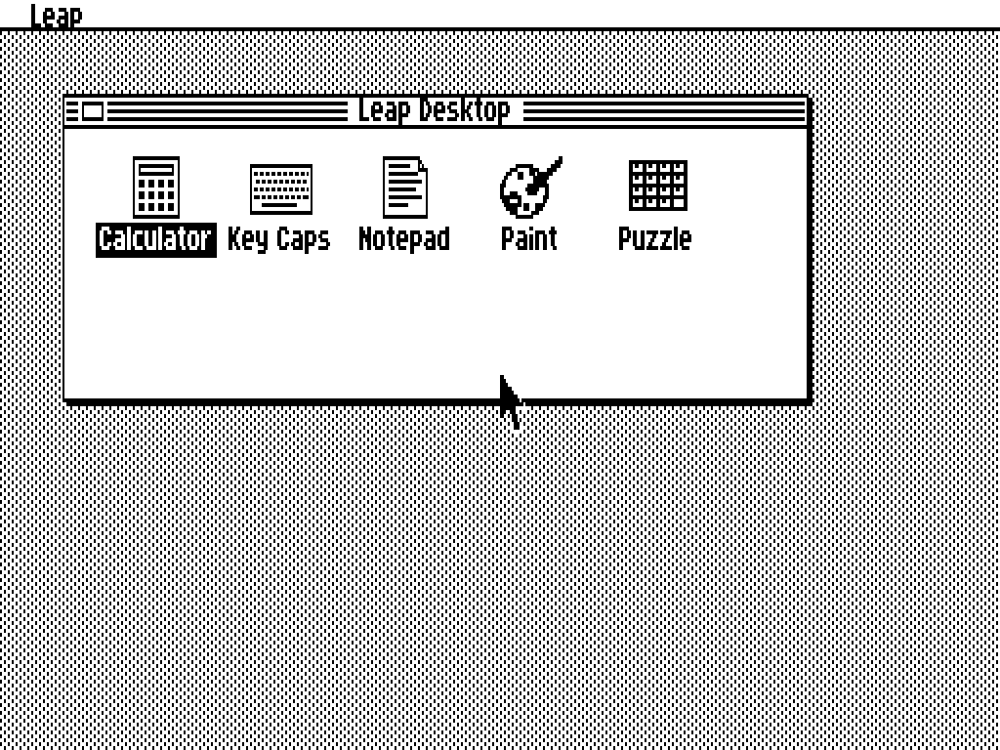

# Leap Desktop

A GEOS-style graphical desktop for the **Timex Sinclair 2068**, built from Leap technology (Leap V2 and Leap Arcade). It runs from a
DOCK cartridge, uses the 512x192 64-column video mode, and is tested on emulators.

**Status:** `desk5`, a 56 KB DOCK cartridge, boots into a desktop with overlapping windows, menus, a Kempston mouse and sound, and six programs: the shell, Calculator, Key Caps, Notepad, Paint and a 15-tile Puzzle. It is tested on TSRun (headless and in the browser), ZEsarUX 13.0 and Fuse 1.9.1; the design and the plan are in [`docs/FEASIBILITY.md`](docs/FEASIBILITY.md), and `CLAUDE.md` holds the working notes.

| ▶ [**Try it in your browser**](https://nchiker.github.io/2068-Leap-Desktop/web/?cart=desk5) | 📖 [**Technical document**](https://nchiker.github.io/2068-Leap-Desktop/) | ⬇ [**desk5.dck**](pages/desk5.dck) | 🗂 [**Design docs**](docs/) |
|:---:|:---:|:---:|:---:|



The live page runs the cartridge on [TSRun](https://github.com/nchiker/TSRun), a TS2068 emulator in the browser; click the screen to give it the keyboard.
[`docs/TECHNICAL.md`](docs/TECHNICAL.md) explains how it works (the same text is the front page of the live site). The page serves the prebuilt
`pages/desk5.dck`; refresh it with `node tools/build.mjs desk5 && cp build/desk5.dck pages/desk5.dck`. Emulator-qualified, not yet tried on a real TS2068.

## Layout

| Path | What |
|---|---|
| `src/` | Z80 assembly (sjasmplus). `hello.asm` is the smoke cartridge |
| `tools/build.mjs` | Assembles every target into `build/<name>.dck` (DOCK bank 0, chunks 0, 1, 4, 5) |
| `tests/` | Headless tests on TSRun under Node (`lib.mjs` is the harness) |
| `web/` | Browser test page: TSRun running a cartridge |
| `tsrun/` | TSRun emulator, git submodule, pinned to the commit Leap-IDE uses |
| `docs/` | Feasibility review, provenance of reused code |

## Use

Needs `sjasmplus` (1.23) on the PATH and Node 24.

```sh
git submodule update --init       # TSRun
node tools/build.mjs              # build/hello.dck
node tests/hello.mjs --pgm        # headless test; --pgm writes build/hello.pgm
python3 -m http.server 8080       # then open http://localhost:8080/web/?cart=hello
```

## Credits

Leap Desktop stands on other people's and other projects' work:

- **[TSRun](https://github.com/josef-jelinek/TSRun) by Josef Jelinek** is the TS2068 emulator that every test here runs on and that runs the live page. This repo pins a [fork](https://github.com/nchiker/TSRun) (`tsrun/`, a submodule) with a Kempston mouse and a host file bridge added; the emulator itself, and the idea of testing a TS2068 program headless under Node, are his.
- **[2068-Leap](https://github.com/nchiker/2068-Leap) (Leap V2, MIT)**: the font table, the kernel conventions and the technology this desktop is built from. **[2068-Leap-IDE](https://github.com/nchiker/2068-Leap-IDE)** and Leap Arcade supplied the DOCK cartridge builder (`tools/mkdck.mjs`), the fast-boot test helper and the proof of TSRun's silent-AY speed-up. Each copied file is listed in [`docs/PROVENANCE.md`](docs/PROVENANCE.md).
- **[2068-TSPico-Study](https://github.com/nchiker/2068-TSPico-Study)**: the shape of the file interface (open, read, write, close by name) follows TS-Pico's channel calls.
- **[zxdesk](https://github.com/mindbox77/zxdesk) by Damian Cooper (MIT)**, a desktop for the 48K Spectrum: read for ideas (timing method, relocatable programs, interrupt-safe fills). No code was copied.
- **[ZEsarUX](https://github.com/chernandezba/zesarux)** and **[Fuse](https://fuse-emulator.sourceforge.net/)** (the Free Unix Spectrum Emulator) for the cross-emulator checks, **[sjasmplus](https://github.com/z00m128/sjasmplus)** for the assembler, and **[marked](https://github.com/markedjs/marked)** (MIT) for rendering the technical document on the site.
- **The TS2068 Technical Manual** (Timex) is the hardware reference; it is not distributed here.
- The look is inspired by the original Macintosh's, and Paint by MacPaint; GEOS is the older inspiration for a desktop on an 8-bit machine. All bitmaps here are drawn for this project.

Leap Desktop's own code and documents are under the [MIT License](LICENSE). The submodule and the vendored ROMs keep their own terms: TSRun carries no licence file of its own, and its ROM files are described in `tsrun/roms/README.md` (the TS2068 ROMs are free for non-commercial use or abandonware; the Leap ROMs are MIT). This is an independent community project, not affiliated with Timex, Sinclair, Amstrad, Apple, Fuse or ZEsarUX.

## Reused code

Code copied from the other Leap projects is listed, with source commits, in [`docs/PROVENANCE.md`](docs/PROVENANCE.md). Leap V2
(`~/2068-Leap`) stays frozen and is never edited from here.

The TS2068 Technical Manual is the hardware reference. It is kept locally in `docs/` and is not committed (third-party document).
Download: https://www.retromaniek.pl/wp-content/uploads/2019/09/Timex-Sinclair-2068-Technical-Manual-best.pdf
